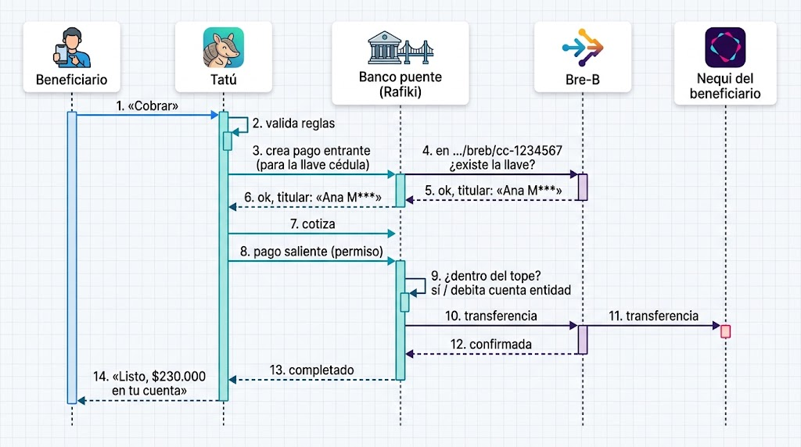

# Piloto 1: plan Bre-B (cobrar a tu llave, sin crear wallet)

> Parte del [plan general](./README.md). **Estado (13 de octubre de 2026): ejecutado.** Documentos
> del evento (§ 5), backend (§ 3) y frontend (§ 4) hechos y probados; lo que cambió frente al plan y lo
> que falta probar está en el § 10. Nace de la comparación con Bizum: la gente adopta un medio de pago
> cuando no tiene que aprender nada nuevo. Hoy, para cobrar a su cuenta, el beneficiario necesita
> una wallet Open Payments y escribir su *wallet address*: casi nadie la tiene en Colombia. En
> cambio, millones ya tienen una **llave Bre-B** (cédula, celular, correo o @alias).

---

## 0. La idea en una frase

**Tatú sigue hablando solo Open Payments; un banco puente con Rafiki traduce a Bre-B.** El
beneficiario cobra a la cuenta que ya usa (Nequi, Daviplata, cualquier banco) con su llave. No crea
wallet, no descarga nada, no ve ninguna URL. Tatú sigue sin tocar la plata, y el tope lo sigue
haciendo cumplir el banco de la entidad.

### Qué cambia en el pitch

| Antes | Después |
|---|---|
| «Llega en segundos a tu wallet» (Bre-B también lo hace: es el punto débil frente al jurado) | «La plata solo sale si la persona aparece; lo que nadie cobra nunca sale» |
| El beneficiario necesita una wallet Open Payments | **Cobra a la llave que ya tiene**; sin cuenta, en un punto con su cédula |
| Bre-B es una amenaza («¿por qué no usar Bre-B directo?») | **Bre-B es la carretera; Tatú decide quién pasa, cuándo y cuánto** |
| — | «Tatú no le paga a un alias, le paga a una persona» (verificación de la llave, § 2) |

### Dónde sirve una llave y dónde no

| Lado | ¿Puede ser una llave Bre-B? | Por qué |
|---|---|---|
| **Destino** (beneficiario o punto) | Sí | Una llave dice **a dónde llega** la plata |
| **Origen** (la cuenta de la entidad) | **No: tiene que ser una wallet Open Payments** | Tatú necesita un permiso con tope (GNAP) en el banco de la entidad para sacar plata. Bre-B es de empuje: no tiene permisos delegados. Una llave sirve para recibir, no para que un tercero debite. La entidad sí puede **fondear** su wallet Open Payments recibiendo por su llave Bre-B |
| **Llave real → Test Wallet** | No | La Test Wallet no es participante de Bre-B y mueve plata de prueba. Solo el **simulador** traduce llaves a wallets de la Test Wallet |

---

## 1. Qué hay hoy y qué cambia

Revisado en `piloto-v2` (commit `c715748`).

| Paso del diagrama | Hoy en el código | Con Bre-B |
|---|---|---|
| 1. «Cobrar» | `POST /cobros` (`api/src/cobros/rutas.ts`) | Igual |
| 2. Valida reglas | `solicitar()` y `reglas.ts` | Igual |
| 3. Crea pago entrante | `op.crearPagoEntrante()` en `pagar()`, hacia `destinoDe()` | Igual: el destino es la wallet de la llave |
| 4 a 6. ¿Existe la llave? Titular | **No existe** | **Nuevo:** `puente.resolverLlave()` al enlazar y otra vez al cobrar (§ 3.2) |
| 7. Cotiza | **No existe:** el piloto usa la forma B (AD-10), pago saliente directo sobre el entrante, sin *quote* | Igual. El diagrama corregido, sin este paso, está en la Arquitectura § 3.4 (en Mermaid) |
| 8 y 9. Pago saliente con tope | `op.crearPagoSaliente()` y `TopeSuperado` | Igual |
| 10 a 12. Transferencia Bre-B | — | **En el piloto:** el pago Open Payments a la Test Wallet hace ese papel. **En producción:** el banco puente lo hace con los *webhooks* de Rafiki |
| 13 y 14. Completado | `rn10Resultado()` y el *polling* de la web | Igual |

**Lo importante:** `pagar()` y todo el flujo de pago no se tocan. Cambia **de dónde sale la wallet de
destino** (una llave en vez de una URL escrita a mano) y **cómo se verifica que es de la persona**.

---

## 2. Reglas nuevas (propuesta para `Reglas de negocio.md`)

| ID | Regla | Por qué |
|---|---|---|
| RN-14 | La persona elige el **tipo** de llave: Cédula, Celular, Correo o @Llave. Nunca se adivina por el formato | Un celular y una cédula nueva tienen 10 dígitos los dos |
| RN-15 | Una llave **tipo cédula** queda Verificada sola si coincide con la cédula del beneficiario | Bre-B solo deja registrar una cédula como llave a su titular |
| RN-16 | Una llave de **otro tipo** solo queda Verificada si el banco puente confirma que su titular es la cédula del beneficiario, además del PIN | Evita que un tercero enlace su @alias a la cédula de otro |
| RN-17 | «Cobrar a mi cuenta» sin cuenta enlazada **prueba primero la llave cédula**; si no existe, ofrece enlazar otra llave o cobrar en un punto | Cero pasos para quien ya tiene su cédula en Bre-B (lección de Bizum) |
| RN-18 | La llave se **vuelve a resolver en cada cobro** | La persona puede mover su llave de Nequi a otro banco entre el enlace y el cobro |

---

## 3. Backend

### 3.1 Banco puente simulado (`/api/puente`), con el mismo patrón que la liquidación

Tatú lo consume **por HTTP** (`PUENTE_URL`), nunca con SQL, igual que `/api/liquidacion`
(`api/src/liquidacion/`). Así, en producción se cambia la URL por la del banco real sin tocar el
resto.

| Archivo nuevo | Qué tiene |
|---|---|
| `api/src/db/migraciones/030_puente.sql` | Esquema `piloto_puente` con la tabla `llave (tipo, valor, documento_titular, nombre_titular, billetera, creado_en)`, `UNIQUE (tipo, valor)` y RLS activada. `billetera` es la wallet **real** de la Test Wallet a la que llega la plata |
| `api/src/puente/contrato.ts` | Esquemas Zod: `TipoLlave`, `Llave`, `Resolucion { existe, titular (enmascarado), billetera }`, `Coincidencia { pertenece }` |
| `api/src/puente/router.ts` | El simulador: `GET /llaves/:tipo/:valor`, `POST /llaves/:tipo/:valor/pertenece { documento }` (responde sí o no **sin revelar la cédula**), `POST /llaves` y `DELETE /llaves/:tipo/:valor` (para «Equipo de prueba», que hace de banco de cada persona) |
| `api/src/puente/datos.ts` | Lecturas y escrituras del esquema `piloto_puente` (solo las usa el simulador) |
| `api/src/puente/cliente.ts` | Lo que usa Tatú: `resolverLlave()`, `pertenece()`, `PuenteNoResponde` (503, con timeout de 5 s) |
| `api/src/puente/enmascarar.ts` | «Ana María Rojas» → «Ana M*** R***» |

`.env` y `config.ts`: `PUENTE_URL` (por defecto `${API_BASE_URL}/puente`) y
`PUENTE_SIMULAR_FALLA`, igual que `LIQUIDACION_SIMULAR_FALLA`.

### 3.2 Cambios en Tatú

| Archivo | Cambio |
|---|---|
| `api/src/db/migraciones/031_llaves.sql` | `cuenta_beneficiario` gana `tipo_llave` (enum `cedula`, `celular`, `correo`, `alfanumerica`; NULL = wallet escrita a mano, como hoy) y `llave text`. Las dos van juntas (CHECK). `billetera` sigue igual y guarda la última resolución |
| `api/src/cuentas/servicio.ts` | `enlazar()` acepta `{ tipoLlave, llave }` **o** `{ billetera }` (lo de hoy, como opción avanzada). Con llave: resuelve en el puente → si es cédula y coincide, Verificada (RN-15); si no, `pertenece()` + PIN (RN-16); si no pertenece, `422 LlaveDeOtraPersona`. Ese camino no usa el permiso interactivo con `subject` |
| `api/src/cuentas/servicio.ts` | Nueva `enlazarCedula(documento)` para RN-17: crea la cuenta Verificada si la llave cédula existe; si no, `404 SinLlaveCedula` |
| `api/src/cuentas/rutas.ts` | `EntradaCuenta` pasa a ser una unión (llave o billetera). Nueva `POST /cuentas/cedula`. Las dos van en `RUTAS` de `openapi.ts` |
| `api/src/cobros/orquestacion.ts` | `destinoDe()`: si la cuenta tiene `tipo_llave`, vuelve a resolverla (RN-18). Si la llave ya no existe, el cobro queda `Rechazado` con el motivo `LlaveNoExiste` **antes** de crear el pago entrante: no se mueve plata |
| `api/src/cobros/mensajes.ts` | Motivos nuevos: `LlaveNoExiste` («Tu llave Bre-B ya no existe; enlaza otra o cobra en un punto»), `PuenteNoResponde`. `motivo_rechazo` es `text`, así que no hay migración |
| Textos de la línea de tiempo | «Bre-B encontró tu llave» y «Enviando a tu llave Bre-B». **Sin el nombre del titular:** se muestra al confirmar, pero no se guarda (RNF-06) |
| `api/src/comun/vistas.ts` | `vistaCuenta` muestra `tipoLlave`, la llave enmascarada (`300***4567`, `@seb***`) y el titular, nunca la wallet de la llave |
| `GET /api/estado` | Una línea más: «Puente Bre-B: simulado» y si responde |

### 3.3 Pruebas (Vitest, PGlite en memoria)

1. Llave cédula que coincide → Verificada sin PIN ni permiso interactivo.
2. Llave cédula de **otra** persona → rechazada.
3. @alias de otra persona con el PIN correcto → `LlaveDeOtraPersona` (RN-16).
4. RN-17: cobrar sin cuenta con llave cédula existente → se crea la cuenta y se cobra; sin llave → `SinLlaveCedula`.
5. RN-18: la llave cambia de wallet entre el enlace y el cobro → el pago llega a la wallet nueva.
6. La llave se borra antes del cobro → `LlaveNoExiste` y **ningún** pago entrante creado.
7. Puente caído → `PuenteNoResponde`, sin cobro a medias.
8. La wallet escrita a mano (camino de hoy) sigue funcionando: las 120+ pruebas actuales pasan sin cambios.
9. `openapi.test.ts` con las rutas nuevas.

**Estimado backend: 1 día.**

---

## 4. Frontend (funcional y responsive, para PC y celular)

| Pantalla | Cambio |
|---|---|
| `web/src/vistas/beneficiario/EnlazarCuenta.tsx` | Selector de tipo con 4 botones grandes (Cédula · Celular · Correo · @Llave) y debajo, plegado, «Tengo una wallet Open Payments» (lo de hoy). Paso de confirmación: «¿Eres **Ana M\*\*\* R\*\*\***?» y PIN. Errores claros para llave inexistente o de otra persona |
| `web/src/vistas/beneficiario/CobrarCuenta.tsx` | Sin cuenta enlazada: botón principal **«Cobrar a mi cédula (Bre-B)»** (RN-17). Si no tiene llave cédula: «Enlazar otra llave» o «Cobrar en un punto» |
| `web/src/vistas/beneficiario/Inicio.tsx` y `CobroPagado.tsx` | Muestran «a tu llave Bre-B 300\*\*\*4567» en vez de la wallet corta |
| `web/src/vistas/Equipo.tsx` | Por persona: «Llaves Bre-B» (tipo, valor y wallet de la Test Wallet a la que llegan). Hace de banco de cada persona, igual que hoy hace de gobierno. Atajo: «Registrar su cédula como llave» |
| `web/src/vistas/Estado.tsx` | La línea del puente |
| `web/src/api/tipos.ts` y `web/src/api/simulada/servidor.ts` | Tipos nuevos y el doble de pruebas del modo `dev:simulada` |

Prueba manual en 375 px y 1366 px: enlazar con cada tipo de llave, el rechazo por llave ajena y un
cobro real de punta a punta.

**Estimado frontend: medio día a 1 día.**

---

## 5. Documentos para el evento (lo que de verdad se lleva el 16)

El código del piloto es desechable (la Guía descalifica el código escrito antes del evento); el
diseño sí se lleva.

| Documento | Cambio |
|---|---|
| `Reglas de negocio.md` | RN-14 a RN-18 (§ 2) |
| `Historias de Usuario — Bonos con Destino.md` | HU-07 pasa a «Enlazar mi llave Bre-B» con sus criterios nuevos. Nueva historia: «Cobrar a mi cédula sin enlazar nada» |
| `Documento de Arquitectura — Hackathon Open Payments.md` | **AD-21: banco puente con Rafiki y Bre-B**: qué es, por qué Tatú no se conecta directo a Bre-B, el diagrama y qué se simula en la demo |
| `Documento Guía — Hackathon Open Payments.md`, § Demo y pitch | Reordenar el pitch (tabla del § 0) y una diapositiva de «camino a producción» |
| Guía, preguntas del jurado | Respuestas ensayadas: «¿El beneficiario tiene que crear una wallet?», «¿Por qué no usar Bre-B directo?», «¿Y si un banco hace lo mismo?», «¿Qué pasa si alguien enlaza el alias de otro?» |
| `Resumen para el equipo.md` | Un párrafo con la idea y el enlace a este plan |

**Estimado: medio día.**

---

## 6. Qué hay que averiguar antes del pitch

Revisado el 13 de octubre en el [documento técnico de Bre-B del Banco de la República (febrero de
2026)](https://d1b4gd4m8561gs.cloudfront.net/sites/default/files/publicaciones/archivos/documento-tecnico-bre-b-febrero-2026.pdf).

**Confirmado:**

- [x] Tipos de llave: número de celular, número del documento de identificación, correo electrónico, códigos alfanuméricos y códigos de comercio.
- [x] Cada llave está asociada a **una sola cuenta** (regla de unicidad del DICE), y una persona puede tener varias llaves. Al 31 de enero de 2026 había 99 millones de llaves de 33,9 millones de clientes (2,9 llaves por cliente).
- [x] La llave se necesita para **recibir**, no para enviar. La persona la registra ante su propia entidad, sobre su cuenta, y algunas entidades cargaron llaves alfanuméricas por defecto a sus clientes.
- [x] Una transferencia tarda **20 segundos como máximo** y no puede pasar de **1.000 UVB**; cada entidad puede bajar ese límite.
- [x] Las transferencias entre personas no le cuestan nada al usuario final.
- [x] Los **pagos masivos** («dispersar a múltiples llaves en un archivo») y los **pagos de empresas a personas** todavía están en la agenda de ampliación, no en las reglas actuales.

**Sigue abierto** (Arquitectura, P-26 a P-28):

- [ ] P-26: ¿solo el titular puede registrar su número de documento como llave? Lo detalla el anexo 1 de la Circular Reglamentaria Externa DSP-465 (procesos de gestión de llaves). De esto depende RN-15.
- [ ] P-27: ¿Bre-B o un participante pueden responder «esta llave es de la cédula X: sí o no» y devolver el titular enmascarado? El documento técnico no lo dice. De esto depende RN-16 en producción.
- [ ] P-28: ¿cuándo entran en las reglas de Bre-B los pagos de empresa (o entidad pública) a persona?
- [ ] ¿Hay en Colombia algún banco o SEDPE con Rafiki, o con interés? ¿La Interledger Foundation financia esa adopción? Preguntar a los mentores en el evento.
- [ ] Encaje legal de un iniciador de pagos (finanzas abiertas, Decreto 1297 de 2022).

---

## 7. Orden y calendario

| Día | Qué |
|---|---|
| Martes 13 | El equipo aprueba o ajusta este plan. Alguien arranca la investigación del § 6 |
| Miércoles 14 | Backend (§ 3) con sus pruebas. Documentos (§ 5) en paralelo |
| Jueves 15 | Frontend (§ 4), cobro real de punta a punta entre el equipo y ensayo de las respuestas al jurado |
| Viernes 16 | Evento: se construye desde cero con el diseño ya actualizado |

Si el tiempo no alcanza: **los documentos (§ 5) van primero.** Son lo que se lleva al evento; el
piloto solo valida.

---

## 8. Decisiones del equipo (13 de octubre)

| # | Pregunta | Decisión |
|---|---|---|
| 1 | ¿Se implementa en el piloto o solo se actualizan los documentos? | Las dos cosas, con los documentos primero |
| 2 | ¿Se mantiene la wallet Open Payments escrita a mano? | Sí, como opción avanzada: es lo que demuestra Open Payments puro |
| 3 | ¿Los puntos y comercios también se registran con llave? | Después: no hace falta para la demo |
| 4 | ¿Se corrige el diagrama (paso 7, «cotiza»)? | Sí: la versión corregida está en la Arquitectura § 3.4 |

---

## 9. Fuera de alcance

- **Conexión real a Bre-B.** Solo la tienen los participantes vigilados; en la demo se simula y se dice que es simulado.
- **Rafiki propio.** El papel del banco puente lo hace el simulador más la Test Wallet.
- **Despliegue en Vercel.** Ojo aparte: si la **API** (no solo la web) va a Vercel como funciones *serverless*, `disparar()` (`api/src/cobros/orquestacion.ts`) lanza el pago después de responder y la función puede congelarse con el cobro en «Pagando». AD-17 ya dice «Render o Railway para la API».

---

## 10. Resultado (13 de octubre)

**Hecho y probado:** 185 pruebas de la API en verde (16 nuevas en `api/src/puente/llaves.test.ts`), 20
de la web, y el typecheck de las dos. En el navegador, con una instancia aislada (base PGlite propia,
puertos 3102 y 5176, configuraciones `api-breb-3102` y `web-breb-5176` de `.claude/launch.json`), en
PC y en 375 px:
- «Equipo de prueba» registra a una persona con su cédula como llave Bre-B y lista las llaves.
- «¿Eres Ana P\*\*\* R\*\*\*?» al buscar una llave.
- El celular de otra persona se rechaza aun con el PIN correcto: «Esa llave no está a tu nombre» (RN-16).
- El @alias propio queda Verificado y se muestra como «Bre-B · @lui\*\*\*».
- «Cobrar a mi cédula» sin llave muestra «Enlazar otra llave» o «Cobrar en un punto» (RN-17).

**Cambios frente al plan:**

| Plan | Quedó así | Por qué |
|---|---|---|
| `POST /cuentas/cedula` para RN-17 | Sin ruta nueva: `POST /cobros` en el canal cuenta prueba la cédula como llave y la enlaza sola (`cuentaPorCedula()`) | Un paso menos para la persona y para la web |
| RN-18 en `destinoDe()` | En `solicitar()`, antes de pasar a Pagando (`refrescarLlave()`) | Así el rechazo queda `Rechazado` sin crear el pago entrante; `destinoDe()` no cambió |
| — | Ruta nueva `GET /cuentas/llaves/:tipo/:valor` | Para el «¿Eres…?» antes de enlazar |
| Atajo «registrar su cédula como llave» en Equipo | `POST /beneficiarios` con `cobraCon: llaveCedula`, más la sección «Llaves Bre-B (banco simulado)» | Permite probar RN-17 desde cero |
| `CobroPagado.tsx` muestra la llave | Sin cambio: muestra la wallet del cobro | El cobro guarda la wallet a la que se pagó |
| El modo `dev:simulada` simula Bre-B | Solo tipos | El flujo Bre-B se prueba con la API de verdad (o la instancia aislada) |

**Rutas:** 52 (6 nuevas: la consulta de la llave y 5 del banco puente simulado). Detalle en
[API del piloto](./API%20del%20piloto.md) § 2 y § 7.

**Ojo con Supabase:** la API que estaba corriendo con `pnpm dev` (puerto 3000) se recargó sola con el
código nuevo y aplicó `030_puente.sql` y `031_llaves.sql` en la base del equipo: el esquema
`piloto_puente` y dos columnas en `piloto.cuenta_beneficiario`. No toca `public`.

**Falta probar:** un cobro real de punta a punta con la Test Wallet a una llave Bre-B. Hay que aprobar
un programa en la Test Wallet, así que lo hace el equipo: registrar a alguien con `cobraCon` «Su cédula
como llave Bre-B», entrar como esa persona y «Cobrar a mi cédula».

