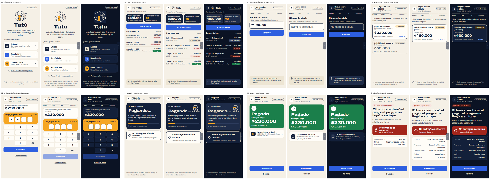
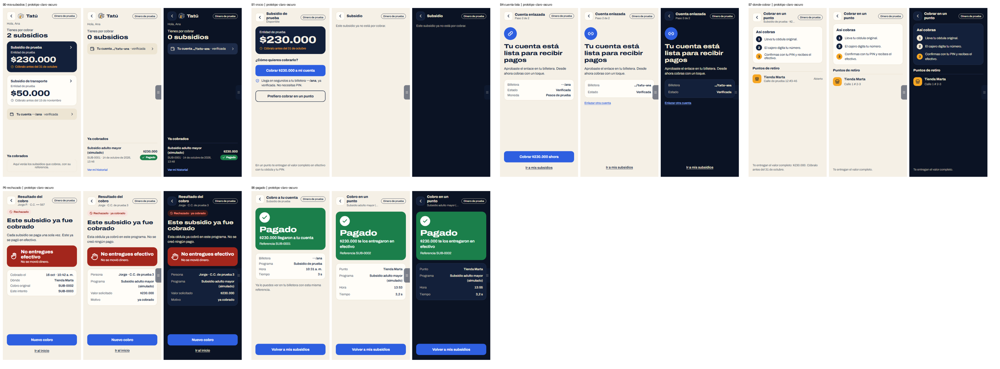
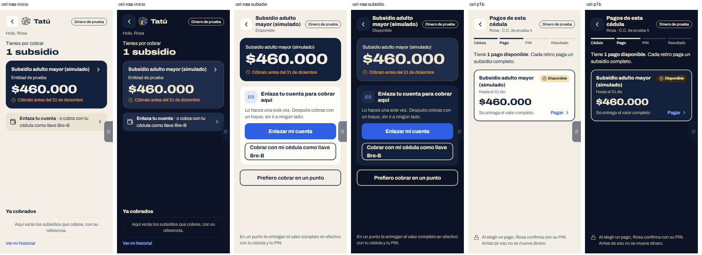
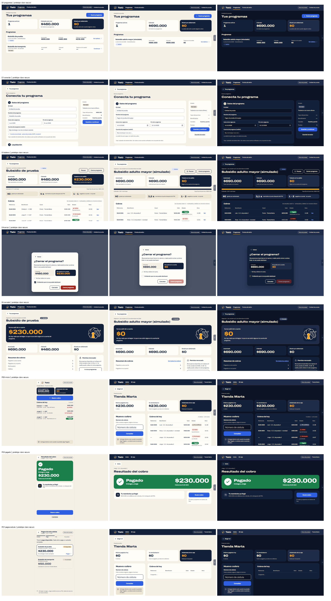

# Plan: el front del piloto igual al prototipo HTML

**Estado:** aplicado en `piloto-v2` (14 oct 2026). Resultado en § 6.

## 1. Qué trae el HTML (medido en su código)

- **Celular** (`.screen.phone`): una columna de **480 px como máximo**, centrada, con borde a los
  lados desde 560 px. Relleno de 18/20/24 px y separación de 14 a 22 px. **No hay barra de abajo.**
- **Cabecera de celular:** un botón ‹ de 44 px (borde `#E2D8C4`, fondo `#FFFDF8`, radio 12) y luego
  una de dos cosas: el ícono de 32 px con «Tatú» (800 al 125 %, 21 px), o el título de la pantalla
  (18 px, 800) con su subtítulo (14 px, `#4A5468`). A la derecha, la pastilla «Dinero de prueba»
  (13 px, borde de 1,5 px en Noche).
- **Escritorio** (entidad y punto desde 960 px): barra Noche con contenido de 1.240 px, el ícono de
  38 px con «Tatú» (24 px), pestañas de 16 px con la activa subrayada en ámbar, «Dinero de prueba» y
  el nombre. Debajo, el botón «‹ Elegir rol», el subtítulo de 15 px y el título de 34 px (800 al
  125 %).
- **Piezas:**
  - Tarjetas de cifra: radio 20, cifra de 38 px; la destacada en Noche con la cifra ámbar y el
    texto `#C9C2B3`.
  - Botones grandes: 56 px, radio 14, 18 px 700; el primario es Azul vivo y el secundario va con
    borde de 2 px en Noche.
  - Chips: 13 px 700, radio 999, con ícono propio. Pagado `#1B7F4B` con texto blanco; rechazado y
    fallido `#A3261C` sobre `#F8E4DF`; activo `#1E4FC8` sobre `#E3E9FB`.
  - Filas de lista con línea de 1 px y aviso en `#EDE5D3`.
- **Sin modo oscuro y sin animaciones**: no hay tatú rodando. «Pagando» es una tarjeta Noche con
  una barra o con pasos, y «Pagado» es un ✓ en un círculo.

## 2. Pantalla por pantalla

| HTML | Vista del piloto | Cambio |
|---|---|---|
| Main | `Entrada` | Filas de rol del HTML (las selecciones de prueba ver § 3) |
| E0 Tus programas | **nueva** `/entidad` | Lista de programas con sus cifras (`GET /programas`, tablero de cada uno) |
| E1 Conectar | `ConectarPrograma` | Secciones numeradas y resumen a la derecha, como el HTML |
| E2 Aprobar | `AprobarEnBanco` | Igual al HTML |
| E3 Tablero | `Tablero` | Igual al HTML (cifras, barra, mini-datos, tabla) |
| E4 Cerrar | `CerrarPrograma` | Modal del HTML |
| E5 Cerrado | `ProgramaCerrado` | Igual al HTML |
| P0 / PD0 Inicio del punto | `InicioPunto` / `NuevoCobro` | Celular: cifras, «Nuevo cobro», cobros de hoy. PC: la versión PD0 |
| P1 Nuevo cobro | **paso propio** `/punto/nuevo` | Cédula con la barra de 4 pasos |
| P1b / PD1 Pagos de esta cédula | paso dentro del cobro | Siempre se muestra, aunque haya un solo pago (hoy se salta) |
| P2, P3 / PD2 PIN | `CobroEnPunto` | Bloque ámbar, casillas y teclado del HTML |
| P4 Pagando | `CobroEnPunto` | Tarjeta Noche con barra, sin el tatú |
| P5 / PD3 Pagado | `CobroEnPunto` | Tarjeta verde con ✓, sin el tatú |
| P6 / PD4, P7 Rechazado y fallido | `CobroEnPunto` | Igual al HTML |
| B0 Mis subsidios | `Inicio` del beneficiario | Lista de subsidios, fila de la cuenta y «Ya cobrados» |
| B1 / B2 Subsidio | **nueva** `/beneficiario/subsidio/:programaId` | Con cuenta: «Cobrar a mi cuenta»; sin cuenta: «Enlaza tu cuenta» |
| B3 / B4 Enlazar y cuenta lista | `EnlazarCuenta` | Igual al HTML (Bre-B ver § 3) |
| B5 / B6 Pagando y pagado | `CobroPagado` | Igual al HTML |
| B7 Cobrar en un punto | `DondeCobrar` | Igual al HTML |

**Se quedan como están** (no están en el HTML): `Equipo`, `EquipoLlaves`, `Estado`, `Historial`,
`MiCaja`, `DetalleCobro`, `DondeUsarBono`, `VentaConBono`, `BancoSimulado` y la pantalla de carga.
Las pestañas que el HTML deja sin pantalla («Mi caja», «Puntos de retiro») llevan a la vista que ya
existe (`/punto/caja`, la sección de puntos del equipo).

## 3. Decisiones (14 oct 2026)

1. **Modo oscuro: se queda.** Cada color del HTML tiene su par en la paleta Noche del
   [Plan modo oscuro](Plan%20modo%20oscuro.md). Lo que se copia al 100 % es el diseño de las vistas:
   estructura, tamaños, colores y patrones.
2. **Probar como:** un panel lateral con los selectores de persona, punto y programa, más Equipo de
   prueba, Estado y el interruptor de tema. Copia el «Menú de pantallas» que trae el propio HTML
   (`.dev-tab` / `.dev-panel`). La entrada queda igual al HTML.
3. **Beneficiario en PC:** la columna de 480 px del HTML. La entidad y el punto usan sus versiones
   de escritorio (E*, PD*).
4. **El tatú rodando se queda** en la pantalla de carga y en «Pagando…» (las esperas), dentro de la
   tarjeta Noche del HTML. «Pagado» lleva el ✓ en círculo del HTML.
5. **Bre-B:** la pantalla de enlace es la del HTML (B3). La llave Bre-B se queda como opción con el
   mismo estilo, porque es como cobran hoy (no se quita una función que ya anda).

## 4. Hallazgos

- **H-12** · Esto cambia la regla del piloto de que «cada vista se adapta a PC con columnas»
  (feedback del 10 oct). El HTML solo trae versión PC para la entidad y el punto.
- **H-13** · El HTML es de antes de Bre-B: el enlace es «Dirección de tu billetera» + PIN.
- **H-14** · El HTML no tiene navegación de abajo; «Mi cuenta» e «Historial» dejan de verse como
  pestañas. Se llega a la cuenta por la fila «Tu cuenta», y lo cobrado está en «Ya cobrados».

## 5. Verificación

`pnpm typecheck`, `pnpm test` y `pnpm build`. Después, captura de cada pantalla del HTML junto a
la del piloto, con los mismos datos de la demo, a 390 y 1280 px; las imágenes quedan en
`docs/piloto/img/`.

## 6. Resultado (14 oct 2026)

Todas las pantallas del HTML están aplicadas, en claro y en oscuro. Las vistas que no están en el
HTML (`Equipo`, `EquipoLlaves`, `Estado`, `Historial`, `MiCaja`, `DetalleCobro`, `DondeUsarBono`,
`VentaConBono`, `BancoSimulado`) no cambiaron.

(La captura del PIN en el celular es anterior al último ajuste: ya no lleva la barra de pasos, como
el HTML.)

**Piezas nuevas:** `componentes/Proto.tsx` (pantallas, cabeceras, botones, tarjetas, chips, filas,
avisos y pasos), `MarcosProto.tsx` (barras de la entidad y del punto), `PanelPrueba.tsx`,
`lib/useEscritorio.ts` (el punto cambia a su versión de computador desde 960 px, como el script
del HTML) y los tokens del HTML con su par oscuro en `index.css`.

**Pantallas nuevas (están en el HTML):** «Tus programas» (`/entidad`), el subsidio del beneficiario
(`/beneficiario/subsidio/:id`) y el paso de la cédula del punto (`/punto/nuevo`). «Pagos de esta
cédula» se muestra siempre, aunque haya un solo pago.

**Cambios de comportamiento que trae el HTML:**
- Cerrar el programa se confirma con la casilla «Entiendo que no se puede deshacer», que manda la
  palabra que pide la API, en lugar de escribir CERRAR.
- El tablero ya no tiene los filtros de la tabla ni la tarjeta de cobros por canal: los reemplazan
  los mini-datos del HTML.
- En el celular no hay barra de abajo. Se llega a la cuenta por la fila «Tu cuenta», y al
  historial por «Ver mi historial», bajo «Ya cobrados».
- El ‹ del PIN cancela el cobro, para que la cédula no quede con un cobro en curso.

**Verificado:**
- `pnpm typecheck`, `pnpm test` (20) y `pnpm build`.
- Capturas de las pantallas, en 390 y 1280 px, en claro y oscuro.
- Flujo completo en PC: consulta de la cédula, «Pagos de Rosa», PIN con el teclado físico,
  «Pagando…» con el tatú y el fallido por tope del banco.
- Sin scroll horizontal a 375 px en ninguna vista: las tablas se desplazan dentro de su caja.
- El foco cae en el h1 de cada pantalla.
- En el panel de prueba, al elegir otra persona cambia la fila de la entrada.

