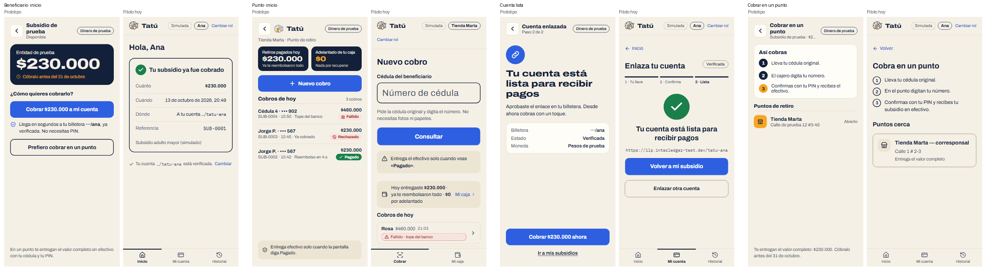
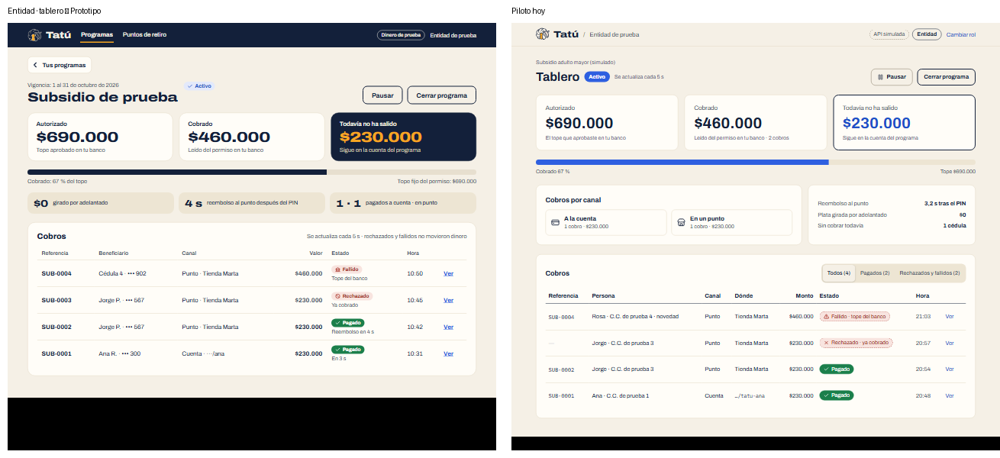
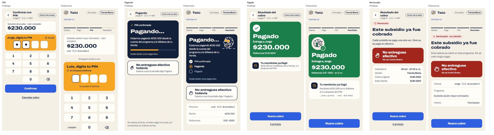
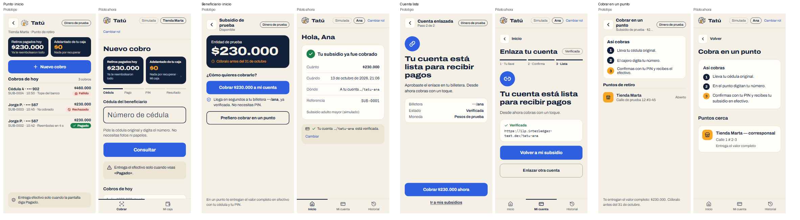
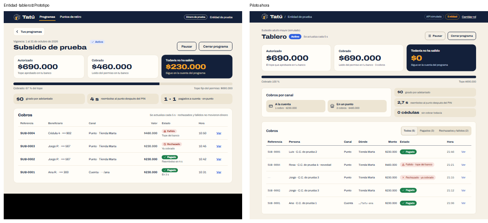

# Plan: aplicar la identidad visual de Tatú al front del piloto

> **Nota (14 de octubre de 2026):** documento histórico; se conserva como se escribió. En `piloto-v2`
> la carpeta `api/` ahora se llama `server/`, la base es Supabase (PostgreSQL con Drizzle) y la web
> y la API están desplegadas juntas en Vercel (<https://test-openpayment.vercel.app>). Lo vigente:
> [Arquitectura, § 3.6](../Documento%20de%20Arquitectura%20—%20Hackathon%20Open%20Payments.md) y [`server/README.md`](../../server/README.md).

**Estado:** primera pasada (§ 2 a § 5) y segunda pasada (§ 6) aplicadas en `piloto-v2` (13 oct
2026). Lo que quedó fuera está en § 6.6.

Fuente: `D:\PRE-Hackathon\FRORNT Y ESTILO VISUAL` (zip con 5 logos SVG, «Exploración de logo.pdf»
con la paleta y `tatu-prototipo.html`). Cierra el pendiente **P-17** del Plan frontend § 6.

## 1. Qué trae la identidad

| Nombre | Color | Uso según el PDF / prototipo |
|---|---|---|
| Noche | `#13203A` | Texto, trazo del logo, fondo oscuro |
| Arena | `#F5F0E6` | Fondo de la app |
| Ámbar | `#F6A623` | Cerradura del logo, acentos (ícono del punto) |
| Azul vivo | `#2E5FE0` | Acciones: botones, enlaces, foco |
| Arcilla / Barro | `#6E4630` / `#9C5A3C` | Tierra, adicional: fondos de apoyo, detalles |
| Pagado (reservado) | `#1B7F4B` | Solo para «Pagado» |

Del prototipo salen además: tarjetas `#FFFDF8`, bordes `#E2D8C4`, texto secundario `#4A5468`,
caja de aviso `#EDE5D3`, rechazo `#A3261C` sobre `#F8E4DF`, «Disponible» sobre `#FCE3B4`, y la
tipografía **Archivo** (variable, ancho 62–125; el logotipo «Tatú» va en 800 al 125 %).

Logos: `claro` (sobre arena), `oscuro` (sobre noche), `tierra` (sobre arcilla), `línea sola` e
`ícono pequeño`.

## 2. Cambios (solo `web/`, el backend no se toca)

1. **Tokens** en `web/src/index.css`: todo el front ya usa variables (`bg-primary`, `text-pagado`…),
   así que casi todo el cambio es aquí.

   | Token | Antes | Después |
   |---|---|---|
   | background | `#ffffff` | Arena `#F5F0E6` |
   | foreground | `#1c1c1c` | Noche `#13203A` |
   | card / popover | `#ffffff` | `#FFFDF8` |
   | primary (botones) | `#1c1c1c` | Azul vivo `#2E5FE0` + texto blanco (5,5:1) |
   | secondary / muted | grises | `#EDE5D3` |
   | muted-foreground / tenue | `#4d4d4d` / `#6b6b6b` | `#4A5468` / `#5A657A` (≥ 4,5:1 sobre arena y `#EDE5D3`) |
   | border / control | `#d4d4d0` / `#8c8c88` | `#E2D8C4` / `#847A66` (`#8F8571` del prototipo da 2,9:1 sobre `#EDE5D3`) |
   | ring / enlace | `#1f55c6` | `#2E5FE0` (foco) · `#1E4FC8` (enlaces, ≥ 4,5:1 también sobre `#EDE5D3`) |
   | pagado | verde gris | `#1B7F4B` en rellenos; texto en `#17703F` (ver hallazgo H-1) |
   | pagando | `#7a4b00` / `#fdf1dc` | Arcilla `#6E4630` sobre `#FCE3B4` (6,5:1) |
   | rechazo / destructive | `#a2231d` | `#A3261C` sobre `#F8E4DF` (6,0:1) |
   | radius | 12 px | 14 px (el prototipo usa 12–18) |

2. **Tipografía**: instalar `@fontsource-variable/archivo` (con eje de ancho) y usarla como
   `--font-sans`; quitar Atkinson Hyperlegible. IBM Plex Mono se queda para direcciones de
   billetera e identificadores.
3. **Logo**: copiar los SVG a `web/public/marca/`. El componente `Logo` (`Encabezado.tsx`) pasa del
   cuadro gris al ícono + «Tatú» en Archivo 800 ancho 125 %.
4. **Entrada** (`vistas/Entrada.tsx`): arriba, el logo claro grande con «Tatú» y la frase del
   prototipo; los íconos de las tres tarjetas de rol con los colores del prototipo (Entidad noche,
   Beneficiario azul, Punto ámbar). Se mantiene el diseño responsive actual (columnas en PC).
5. **Pantallas de éxito** (`CobroPagado`, `CobroEnPunto`, `EnlazarCuenta`): el círculo verde ya usa
   `bg-pagado`; solo se revisa que quede como en el prototipo.
6. **Favicon y `index.html`**: favicon = ícono sobre noche (`tatu-logo-oscuro.svg`),
   `theme-color` `#13203A`.
7. **Sin cambios**: `BancoSimulado.tsx` (imita otro banco, lleva su propio estilo), el layout y la
   navegación, el modo oscuro (el piloto sigue solo en claro; cambió el 14 oct 2026, ver
   [Plan modo oscuro](./Plan%20modo%20oscuro.md)).
8. **Docs**: Plan frontend § 6 (P-17 resuelto) y el comentario de `index.css`.

## 3. Hallazgos para el equipo

- **H-1** · `#1B7F4B` como texto sobre arena da 4,42:1 (< 4,5 de WCAG AA). Propuesta: en rellenos
  (chip «Pagado» sólido con texto blanco, 5,0:1, como el prototipo) se usa tal cual; para texto
  verde se usa `#17703F` (5,4:1).
- **H-2** · Azul vivo `#2E5FE0` como texto sobre `#EDE5D3` da 4,37:1; los enlaces usan `#1E4FC8`,
  que ya está en el prototipo.
- **H-3** · El prototipo es de columna de celular (máx. 480 px). Igual que con los wireframes, se
  toman colores, tipografía y componentes, no el ancho: el front sigue adaptándose a PC y celular.
- **H-4** · Atkinson Hyperlegible se eligió por legibilidad. Archivo es legible a 16 px o más; se
  mantiene el tamaño base de 16 px y las cifras tabulares (`tabular-nums`) del prototipo.

## 4. Verificación

`pnpm typecheck`, `pnpm test` y `pnpm build` en `web/`; abrir el piloto (API simulada) en PC y en
celular (375 px), recorrer Entrada, Entidad, Beneficiario y Punto, revisar contrastes y foco, y
dejar capturas.

## 5. El tatú animado (13 oct 2026)

Se probaron dos variantes en `/demo/tatu` y se eligió la **B**:

- **Pagando…** (`EsperaPagando`, en el punto y el beneficiario): el tatú del ícono rueda sobre un
  suelo de rayitas y la cerradura late. Reemplaza el círculo que giraba.
- **Pagado** (`TatuPagado`, en `CobroEnPunto` y `CobroPagado`): el tatú quieto, la cerradura pasa
  de ámbar a verde con un salto corto y un halo, y un chulito verde al lado para que el cajero no
  dude.
- Con «reducir movimiento» del sistema, el tatú queda quieto y la cerradura cambia sin animación.
  El estado siempre lo dice el texto; el tatú es decorativo (`aria-hidden`).
- **Cargando** (14 oct 2026): `Cargando` (las pantallas que esperan a la API) usa el mismo tatú
  rodando, centrado, en lugar del círculo que giraba; `CargandoEnLinea` es la versión chica para las
  listas («Cobros de hoy», el historial de «Mi caja»). Sirve en claro y en oscuro porque el trazo
  sale del color del texto. Los chips «Pagando» y los botones que recargan conservan su ícono chico.
- **Costo del tatú** (14 oct 2026): antes se animaban un `<g>` dentro del SVG y el
  `background-position` del suelo, y eso recalculaba estilos y layout en cada cuadro. Ahora todo
  es `transform` sobre elementos HTML: el cuerpo en un ``, la cerradura en su propio `<svg>`
  debajo del contorno y el suelo como una tira que se desliza. Medido 3 s con la CPU 4× más lenta:
  el hilo principal pasó de ~1.250 ms a ~550 ms ocupado, con 0 layouts por cuadro. Es lo mismo que
  cuesta el `animate-spin` del círculo que había antes (~580 ms); una página quieta da ~285 ms.
  Además, `Cargando` aparece a los 200 ms (`aparece-tarde`), así que una respuesta rápida no
  muestra un destello. Los datos se piden igual: el tatú no le suma tiempo a la carga.
- Límite: cabeza y caparazón son un solo trazo; para animarlos aparte u otras poses de mascota hace
  falta redibujar el logo (Rol 5).

## 6. Segunda pasada: el lenguaje del prototipo (aplicada, 13 oct 2026)

### 6.1 Qué se revisó

Se capturaron las 29 pantallas de `tatu-prototipo.html` (celular 390 px y PC 1280 px) y las vistas
del piloto con la API simulada y el «escenario de la demo», y se compararon una a una.

- Los 5 SVG del zip son **idénticos** a los de `web/public/marca/`: los logos ya están.
- Ya está: paleta en tokens, Archivo, logo en el encabezado y la entrada, chips de estado, favicon,
  tatú animado.
- **Lo que falta es el «lenguaje» del prototipo, no los colores**: tarjetas Noche para las cifras
  importantes, cifras y títulos en Archivo ancho, y las pantallas del cobro (PIN, pagando, pagado,
  rechazo) con bloques de color llenos. Hoy el piloto usa tarjetas blancas con borde para todo.

### 6.2 Diferencias encontradas

| # | Dónde | Prototipo | Piloto hoy |
|---|---|---|---|
| D-1 | Cifras ($230.000) | Archivo 800 al 125 % de ancho | Bold normal (`CifraGrande`, montos sueltos) |
| D-2 | Títulos de pantalla | 800 ancho («Este subsidio ya fue cobrado») | Bold normal (`Titulo`) |
| D-3 | Cifra principal | Tarjeta **Noche** con texto arena y acento ámbar | Tarjeta blanca con borde; «Todavía no ha salido» en azul |
| D-4 | PIN (P2, P3) | Bloque **ámbar** «Jorge, digita tu PIN» con reloj, 4 casillas, teclas sobre tarjeta y ⌫ | Texto centrado, 4 puntos, teclas grises «Borrar» / «Limpiar» |
| D-5 | Pagando (P4, B5) | Tarjeta Noche «Pagando…» con pasos (Solicitado · Pagando · Pagado) y aviso «No entregues efectivo todavía» | Tatú animado + barras de pasos + lista de datos |
| D-6 | Pagado (P5, B6) | Tarjeta **verde llena** con ✓, «Pagado», «Entrega a Jorge», cifra y referencia | Tatú pagado + título + texto, sobre arena |
| D-7 | Rechazo / fallido (P6, P7) | Chip + título grande + tarjeta **roja llena** «No entregues efectivo · No se movió dinero» con ícono de mano | Círculo punteado + recuadro con borde negro |
| D-8 | Inicio del punto (P0) | Dos tarjetas Noche: «Retiros pagados hoy» y «Adelantado de tu caja» (ámbar) | Una línea «Hoy entregaste…» en caja gris |
| D-9 | Pasos del cobro en el punto (P1) | Barra «Cédula · Pago · PIN · Resultado» | No hay |
| D-10 | Inicio del beneficiario (B1) | Subsidio en tarjeta Noche, «Cóbralo antes del…» en ámbar, fila «Tu cuenta ···/ana · verificada» | «Hola, Ana» + tarjeta blanca |
| D-11 | Cuenta lista (B4) | Ícono azul de enlace, título ancho a la izquierda, tarjeta de datos | Círculo verde centrado |
| D-12 | Cobrar en un punto (B7) | Pasos con círculos llenos (Noche; el último ámbar); punto con ícono ámbar | Círculos con borde, tarjeta con borde |
| D-13 | Barra de la entidad (PC) | Barra **Noche** con logo oscuro y pestaña activa subrayada en ámbar | Barra arena |
| D-14 | Tablero (E3) | «Todavía no ha salido» Noche + ámbar, avance Noche, mini-datos en `#EDE5D3`, tabla en tarjeta | Tarjeta con borde negro y cifra azul, barra azul |
| D-15 | Aprobar, cerrar, cerrado (E2, E4, E5) | Cifra grande del tope; modal sobre fondo Noche; «Programa cerrado» con tarjeta Noche y logo | Estilo de tarjeta blanca |
| D-16 | Botón «volver» | Cuadro blanco con ‹ junto al título | Enlace «← Volver» |
| D-17 | Chips Rechazado / Fallido | Fondo rojo claro sin borde | Con borde punteado |

### 6.3 Cambios propuestos (solo `web/`; el backend no se toca)

**Fase 1 · Base** (`index.css` y componentes compartidos; arregla D-1, D-2, D-3 y D-17 en todo el front)

1. Utilidad `cifra` (800 al 125 %, `tabular-nums`) para `CifraGrande` y los montos grandes.
2. `Titulo`: 800 con ancho de 112 a 125 % según el tamaño. Los títulos largos se prueban a 375 px
   para que no se corten.
3. `CifraGrande` con variante `noche` (fondo `#13203A`, texto arena y cifra en ámbar si es la
   destacada). Reemplaza a `destacada` y `azul`.
4. Componente `TarjetaEstado` con tres tonos llenos (Noche, verde `#1B7F4B`, rojo `#A3261C`) para
   pagando, pagado y rechazo.
5. Chips de rechazo sin borde punteado.

**Fase 2 · Cobro** (D-4 a D-9; son las pantallas que más se ven en la demo)

6. `TecladoPin` y `PuntosPin`: bloque ámbar con el nombre y el reloj, 4 casillas, teclas sobre
   `bg-card` y «Borrar» como ⌫ con su `aria-label`. «Limpiar» se queda (Escape también limpia).
7. Pagando: `EsperaPagando` dentro de una tarjeta Noche con los pasos del prototipo. En el punto se
   añade debajo «No entregues efectivo todavía».
8. Pagado (`CobroEnPunto`, `CobroPagado`): tarjeta verde llena con ✓, «Pagado», a quién entregar,
   cifra y referencia. Debajo, la tarjeta del reembolso como está.
9. Rechazo (`TarjetaRechazo`): chip + título ancho + tarjeta roja llena + datos en tarjeta.
10. `InicioPunto` / `NuevoCobro`: las dos tarjetas Noche de la caja arriba y la barra de pasos
    Cédula · Pago · PIN · Resultado en el flujo del punto.

**Fase 3 · Beneficiario** (D-10 a D-12)

11. `Inicio`: el subsidio por cobrar en tarjeta Noche, con la fecha límite en ámbar, y la fila de la
    cuenta o la llave Bre-B (`CuentaDestino`) en `#EDE5D3`. «Ya fue cobrado» queda en tarjeta clara
    con chip verde.
12. `EnlazarCuenta` (paso «Lista»): ícono azul, título ancho y datos en tarjeta. Se respeta el
    flujo Bre-B actual (llave · confirma · lista). El prototipo es de antes de Bre-B, así que de él
    solo se toma el estilo.
13. `DondeCobrar`: pasos con círculos llenos y puntos con ícono ámbar.

**Fase 4 · Entidad** (D-13 a D-15)

14. `Encabezado`, variante escritorio: barra Noche con `tatu-logo-oscuro.svg`, textos arena y la
    pestaña activa en ámbar.
15. `Tablero`: tarjeta Noche para «Todavía no ha salido», barra de avance Noche y mini-datos en
    `#EDE5D3`.
16. `AprobarEnBanco`, `CerrarPrograma`, `ProgramaCerrado`: cifra grande del tope, modal sobre Noche
    al 80 % y tarjeta Noche con el logo en el cierre.

**Fase 5 · Detalles**

17. Botón «volver» en cuadro (D-16) en las vistas del beneficiario y del punto que lo tienen.
18. `Equipo`, `EquipoLlaves`, `Estado` y `Entrada` solo heredan la base (fase 1). La entrada
    conserva sus tarjetas con selectores, que hacen falta para probar con cualquier persona.

**Sin cambios:** rutas, textos de negocio, navegación inferior, layout responsive (columnas en PC),
`BancoSimulado` y el backend.

### 6.4 Hallazgos para el equipo

- **H-5** · El prototipo tiene pantallas que el piloto no tiene: «Tus programas» (E0), «Puntos de
  retiro» como sección de la entidad, «Mis subsidios» con varios subsidios (B0) y «Pagos de esta
  cédula» para elegir entre varios pagos (P1b). Son funciones y no estilo, así que quedan **fuera de
  este plan**. Se anotan en el Plan frontend para decidirlas aparte.
- **H-6** · El tatú animado se dibuja con trazo Noche, así que sobre la tarjeta Noche de «Pagando»
  no se ve. Hay que pasarle el color del trazo (arena sobre Noche, como en
  `tatu-logo-oscuro.svg`).
- **H-7** · Contrastes de los bloques llenos (todos ≥ 4,5:1): arena sobre Noche 14,3 · ámbar sobre
  Noche 8,0 · Noche sobre ámbar 8,0 · blanco sobre verde `#1B7F4B` 5,0 · blanco sobre rojo `#A3261C`
  7,4 · blanco sobre azul 5,5.
- **H-8** · El prototipo siempre muestra la pastilla «Dinero de prueba», y el piloto solo marca «API
  simulada». Propuesta: mostrar «Dinero de prueba» siempre (todo pasa por la Test Wallet) y dejar
  «Simulada» solo en el modo simulado.
- **H-9** · El verde de «Pagado» pasa a ser un bloque grande. Sigue reservado para Pagado y va
  siempre con ✓ y texto, nunca solo con color.

### 6.5 Verificación

En `web/`: `pnpm typecheck`, `pnpm test` y `pnpm build`. Después se recapturan las mismas
pantallas, a 390 px y a 1280 px, con la API simulada y el escenario de la demo. Se recorre el cobro
en el punto (PIN bien, PIN mal, pagado, ya cobrado, tope del banco) y el cobro a la cuenta. Se
revisan el foco, el modo «reducir movimiento» y que a 375 px no haya scroll horizontal. Las capturas
de antes y después quedan en `docs/piloto/img/`.

### 6.6 Resultado

Se aplicaron las fases 1 a 5 sin agregar pantallas ni rutas (H-5 sigue fuera). Verificado:
`pnpm typecheck`, `pnpm test` (20) y `pnpm build`; capturas a 390 y 1280 px con la API simulada y
el escenario de la demo (PIN, pagando, pagado, ya cobrado, tope del banco, caja, beneficiario,
tablero, cerrar y cerrado); sin scroll horizontal a 375 px en ninguna vista (la tabla del tablero
se desplaza dentro de su tarjeta, como antes), y el foco cae en el título de cada pantalla.

Qué cambió, por archivo:

- **Base:** `index.css` (utilidades `cifra` y `titular`, tokens `noche-tenue` y `noche-suave`,
  suelo claro del tatú), `Titulo` (800 ancho), `CifraGrande` (variantes `noche` y `ambar`, en lugar
  de `destacada` y `azul`), `Comun` (`Bloque` de color lleno, `Volver` en cuadro), `EstadoCobro`
  (chips sin borde punteado).
- **Cobro:** `TecladoPin` (casillas, teclas sobre tarjeta, ⌫ y «Limpiar»), `PasosDelPago` (pasos
  dentro del bloque Noche), `EsperaPagando` (bloque Noche con el tatú en trazo arena, H-6, y
  «No entregues efectivo todavía»), `TarjetaRechazo` (chip, título y bloque rojo), `TatuAnimado`
  (`sobreOscuro` y `TatuPagado medallon`), `PasosCobroPunto` (nuevo: Cédula · Pago · PIN ·
  Resultado), `CobroEnPunto`, `CobroPagado`, `NuevoCobro` (`CajaDeHoy` en dos tarjetas Noche, con los
  valores reales de la caja).
- **Beneficiario:** `Inicio`, `Historial` (`TarjetaCobrado`), `CobrarCuenta`, `EnlazarCuenta` (solo el
  estilo; el flujo Bre-B no cambia) y `DondeCobrar`.
- **Entidad:** `Encabezado` (barra Noche con el logo oscuro), `Tablero`, `AprobarEnBanco`,
  `CerrarPrograma` (botón rojo y fondo Noche del modal, en `ui/alert-dialog`) y `ProgramaCerrado`.

Quedó fuera, a propósito:

- **H-5:** las pantallas que el piloto no tiene («Tus programas», «Puntos de retiro» de la
  entidad, «Mis subsidios», «Pagos de esta cédula»), y las pestañas de la barra de la entidad que
  llevarían a ellas.
- **H-8:** la pastilla «Dinero de prueba». En el celular, la barra ya lleva el estado de los pagos,
  «Simulada», el rol y «Cambiar rol», y otra pastilla la desborda. Queda para decidir con el equipo.
- `BancoSimulado`, `DemoTatu`, `Equipo`, `EquipoLlaves` y `Estado` solo heredan la base.

