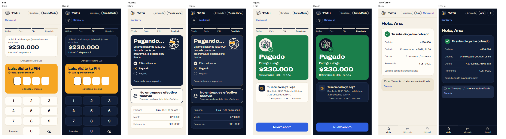
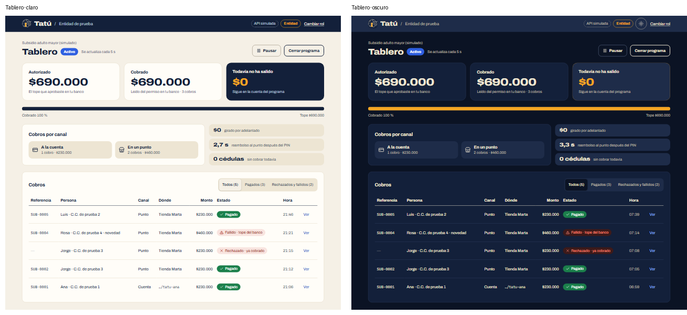

# Plan: modo oscuro del piloto con los colores del logo

> **Nota (14 de octubre de 2026):** documento histórico; se conserva como se escribió. En `piloto-v2`
> la carpeta `api/` ahora se llama `server/`, la base es Supabase (PostgreSQL con Drizzle) y la web
> y la API están desplegadas juntas en Vercel (<https://test-openpayment.vercel.app>). Lo vigente:
> [Arquitectura, § 3.6](../Documento%20de%20Arquitectura%20—%20Hackathon%20Open%20Payments.md) y [`server/README.md`](../../server/README.md).

**Estado:** aplicado en `piloto-v2` (14 oct 2026), con paleta Noche y «sistema + interruptor». Resultado en § 7. Sigue al [Plan identidad visual](Plan%20identidad%20visual.md).

## 1. De dónde salen los colores

El zip trae dos versiones del logo para fondo oscuro, y el modo oscuro puede salir de cualquiera:

| Logo | Fondo | Trazo | Cerradura | Sombra |
|---|---|---|---|---|
| `tatu-logo-oscuro.svg` | Noche `#13203A` | Arena clara `#EFE6D2` | Ámbar `#F6A623` | Barro al 14 % |
| `tatu-logo-tierra.svg` | Arcilla `#6E4630` | Arena clara `#EFE6D2` | Ámbar `#F6A623` | Barro al 22 % |

Hoy el piloto fuerza el tema claro: `color-scheme: light`, y la variante `dark:` de shadcn está
atada a una clase que nadie usa (Plan identidad visual § 2.7).

## 2. Paleta propuesta: «Noche» (sale del logo oscuro)

La propuesta es la paleta Noche. La opción «Tierra» (fondo `#2A1C14`, tarjetas `#3A281D`, texto
`#EFE6D2` 13,3:1) da contrastes parecidos, pero el marrón choca con el rojo de rechazo y con el
ámbar de «Pagando».

| Token | Claro (hoy) | Oscuro | Contraste en oscuro |
|---|---|---|---|
| background | Arena `#F5F0E6` | `#0B1324` (un Noche más hondo) | — |
| foreground | Noche `#13203A` | Arena clara `#EFE6D2` | 14,9 sobre el fondo |
| card | `#FFFDF8` | Noche `#13203A` | texto 13,1 |
| muted / secondary | `#EDE5D3` | `#1E2C49` | — |
| muted-foreground / tenue | `#4A5468` / `#5A657A` | gris arena `#BDB5A3` | 8,0 sobre la tarjeta, 6,8 sobre `#1E2C49` |
| border / control | `#E2D8C4` / `#847A66` | `#2C3B5C` / `#6B7A99` | control 3,8 (solo bordes) |
| primary (botones) | Azul vivo `#2E5FE0` | igual | blanco 5,5 |
| enlace | `#1E4FC8` | `#8DB0FF` | 8,6 sobre el fondo, 7,6 sobre la tarjeta |
| pagado (texto) | `#17703F` | `#5CC98A` | 7,9 sobre la tarjeta |
| pagado (relleno) | `#1B7F4B` | igual | blanco 5,0 |
| rechazo (texto) | `#A3261C` | `#FF8A7A` | 7,1 sobre la tarjeta |
| rechazo (relleno) | `#A3261C` | igual | blanco 7,4 |
| ámbar | `#F6A623` | igual | 9,2 sobre el fondo |

**Bloques Noche** (cifra principal, «Pagando…»): sobre un fondo que ya es oscuro dejan de
resaltar. En oscuro pasan a `#1E2C49` con un borde ámbar fino, y la cifra sigue en ámbar (6,9:1).

## 3. Cómo se activa

Propuesta: sigue al sistema (`prefers-color-scheme`) y además hay un interruptor ☀/☾ en el
encabezado, que se recuerda en `localStorage`. La API simulada y la Test Wallet no cambian.

## 4. Cambios (solo `web/`)

1. `index.css`: los tokens oscuros en `:root[data-tema="oscuro"]` y en
   `@media (prefers-color-scheme: dark)` cuando no hay elección guardada; `color-scheme` según el
   tema; `dark:` de shadcn atado a `[data-tema="oscuro"]` para que los componentes `ui/` también
   cambien.
2. Token nuevo `--bloque` (fondo de los bloques Noche): `#13203A` en claro y `#1E2C49` en oscuro.
   `Bloque`, `CifraGrande`, `CajaDeHoy`, `Inicio`, `CobrarCuenta`, `EnlazarCuenta`, `Tablero`,
   `CerrarPrograma` y `ProgramaCerrado` pasan de `bg-noche` a `bg-bloque`.
3. Logo: en oscuro, el encabezado y la entrada usan `tatu-logo-oscuro.svg`. Hay que cambiar el
   `src`, porque un `` no hereda colores. `TatuAnimado` dibuja el trazo con
   `var(--foreground)` en lugar de Noche fijo, así funciona en los dos temas.
4. Colores fijos: los 5 `bg-white` / `text-white` (casillas del PIN y bloques llenos) se revisan.
   Las casillas del PIN quedan blancas sobre ámbar en los dos temas.
5. Interruptor: componente `Tema` en `Encabezado` (las tres variantes), con `aria-pressed` y
   texto para lector de pantalla, de 44 px de alto.
6. Sin cambios: `BancoSimulado` (imita otro banco) y los colores reservados («Pagado» sigue siendo
   el único verde).

## 5. Hallazgos

- **H-10** · El Plan identidad visual dejó el piloto «solo en claro» como decisión. Este plan la
  cambia, y hay que anotarlo en el Plan frontend.
- **H-11** · `tatu-icono-pequeno.svg` no tiene versión oscura. Para el favicon y el ícono chico se
  usa `tatu-logo-oscuro.svg`, que lleva su propio fondo Noche y se ve bien en los dos temas.

## 6. Verificación

`pnpm typecheck`, `pnpm test` y `pnpm build`. Después, las mismas capturas de la segunda pasada,
en claro y en oscuro, a 390 y 1280 px. Se revisan contrastes, foco, que el interruptor se recuerde
al recargar y que el modo del sistema se respete cuando no hay elección guardada.

## 7. Resultado (14 oct 2026)

Decisiones: paleta **Noche** y activación **sistema + interruptor**.

- **Tokens** (`index.css`): los claros van en `:root, [data-tema="claro"]` y los oscuros en
  `[data-tema="oscuro"]`. Hay tokens nuevos: `--bloque`, `--bloque-texto` y `--bloque-borde`
  (utilidad `bloque`), y `--rechazo-relleno`. Este último hace falta porque en oscuro el texto de
  rechazo es claro y no sirve como fondo de un bloque con texto blanco.
- **Variantes:** `dark:` de shadcn sigue apagada, para que sus grises no pisen la paleta. La
  variante propia es `oscuro:` (cambiar el logo, la barra de avance en ámbar).
- **Ajuste frente al § 2:** el texto secundario pasó de `#AEB8CC` a un gris arena `#BDB5A3`. El
  azulado se confundía con los enlaces (`#8DB0FF`).
- **Activación:** un script en `index.html` pone `data-tema` antes de pintar. `componentes/Tema.tsx`
  tiene el botón ☀/☾ (en las tres variantes del encabezado, con `aria-pressed`), lo guarda en
  `localStorage` (`tatu.tema`) y, si no hay elección guardada, sigue al sistema también en vivo.
  También actualiza `theme-color`.
- **Logo:** en oscuro, el encabezado y la entrada usan `tatu-logo-oscuro.svg`. El trazo de
  `TatuAnimado` sale de `var(--foreground)`, así que funciona en los dos temas.
- **Siempre claro:** `BancoSimulado` (lleva `data-tema="claro"`; imita otro banco). Las casillas
  del PIN siguen blancas sobre ámbar.
- **Botón primario:** el hover pasó de `bg-enlace` a `#2450C4` (blanco 7,0:1), porque en oscuro el
  enlace es azul claro.

Verificado: `pnpm typecheck`, `pnpm test` (20) y `pnpm build`. Se recapturaron en oscuro las mismas
29 pantallas de la segunda pasada, a 390 y 1280 px. En el navegador, sin elección guardada sigue al
sistema; el botón cambia el tema, lo guarda y se mantiene al recargar. Dentro de
`data-tema="claro"` los colores siguen en claro aunque el piloto esté en oscuro.

